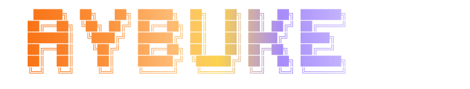

<div align="center">

<!-- Header -->


<br>

`@Pariciia`

<!-- Typing Animation -->


<br>

`3D & Graphics` &nbsp; `Cross-Platform` &nbsp; `Hardware / IoT` &nbsp; `UI Design`

</div>

---

```
$ whoami
> Aybuke Aksoz

$ cat interests.txt
> 3D graphics, cross-platform dev,
> hardware integration, UI design

$ echo $LOCATION
> Istanbul, Turkey
```

---

### Tech Stack

**Languages**


**Frameworks & Libraries**


**Hardware & IoT**


**Tools**


---

### Contributions

<picture>
  <source media="(prefers-color-scheme: dark)" srcset="./profile-3d-contrib/profile-night-green.svg" />
  <source media="(prefers-color-scheme: light)" srcset="./profile-3d-contrib/profile-night-green.svg" />
  
</picture>

<br>

<picture>
  <source media="(prefers-color-scheme: dark)" srcset="./dist/github-contribution-grid-snake-dark.svg" />
  <source media="(prefers-color-scheme: light)" srcset="./dist/github-contribution-grid-snake.svg" />
  
</picture>

---

### Connect

[](https://github.com/Pariciia)
[](mailto:abkeasz@gmail.com)
[](https://www.linkedin.com/in/ayb%C3%BCke-aks%C3%B6z-303969251/)
